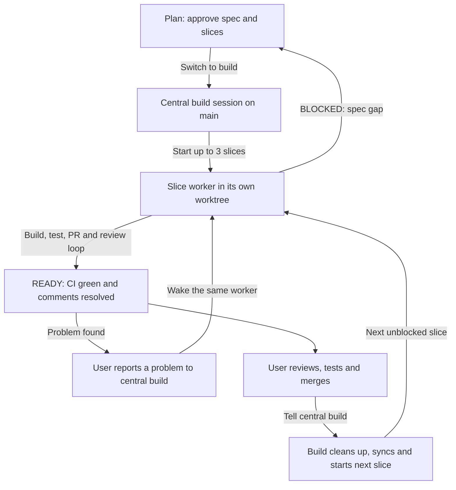

# opencode-config-v2

User-level OpenCode 2.x configuration. It defines one delivery flow —
Define → Plan → Build → Verify → Review → Ship — that behaves identically on the
Mac and on the server, and adds custom pieces only where an external tool
(OpenCode server, GitHub, Sysbox/Docker) has to be integrated.

**This repository is the OpenCode config directory.** It is not an app repo and
holds no app code.

- **On the Mac:** clone it to `~/.config/opencode`. OpenCode then loads
  `opencode.jsonc`, `agents/`, `commands/`, `skills/` and `plugins/` from there
  for every project.
- **On the server:** the opencode-server image clones this repo at `CONFIG_REF`
  into the config directory. Server-only behaviour (gitdir rewrite, delete
  guard, localhost rewrite) lives in opencode-server overrides, never here.

## App repos

Each project lives in one app repo, but that repo does not have to be a
monorepo. [`templates/project/TEMPLATE.md`](templates/project/TEMPLATE.md)
guides both root-level single-app and multi-app architectures: a full-stack
Next.js or TanStack Start app can keep its framework-native layout, while a
React + FastAPI system might use `apps/` and share generated code through
`packages/`. API contracts, generated clients, per-component images, and
build tools apply only when the real architecture needs them. The common
defaults are clear ownership, docs next to code, and idiomatic stack
choices. How the flow tests and runs lint/typecheck services is defined
separately by the test contract in `docs/plan/blueprint.md` (§7.2, §9.2).

## Install

### Mac

1. Back up the old config if any, then clone this repo as the config directory:
   `git clone git@github.com:roborew/opencode-config-v2.git ~/.config/opencode`
   (the old v1 config that lived there is retired — nothing is copied from it).
2. `cd ~/.config/opencode && npm install` — installs `@opencode/plugin`, which the
   plugins in `plugins/` resolve at runtime.
3. `opencode` (2.3.0 pinned) → `/connect` for **OpenCode** (Zen) and **OpenCode Go**, and
   paste the API keys. In Go's **Settings › Privacy › Regions** choose **Global** —
   DeepSeek V4.1 Flash needs it.
4. `gh auth login` — the flow creates issues, labels and PRs through `gh`.
5. Optional: `OC_SANDBOX_BACKEND=docker` forces the local Docker backend (the default
   is auto-detect: sidecar → sysbox, local Docker → docker).
6. Export the required environment variables (see [Environment](#environment)) before
   starting OpenCode.

### Environment

The config reads these when it loads; export them in your shell profile (or let
Infisical inject them on the server) so every session sees the same values.

| Variable                 | Format                                                 | Purpose                                                                                                                                                                                                                            |
| ------------------------ | ------------------------------------------------------ | ---------------------------------------------------------------------------------------------------------------------------------------------------------------------------------------------------------------------------------- |
| `MCPJUNGLE_URL`          | absolute URL, e.g. `https://mcpjungle.example.com/mcp` | Endpoint of the MCPJungle gateway. Required: OpenCode substitutes an empty string when it is unset, and a remote MCP server needs an absolute URL, so the gateway cannot connect without it.                                       |
| `MCPJUNGLE_TOKEN`        | bearer token                                           | Authenticates to the gateway. A 401 "invalid MCP client token" means it is unset or stale.                                                                                                                                         |
| `OPENCODE_WORKTREES_DIR` | absolute path, e.g. `~/.opencode-worktrees`            | Root for slice worktrees (the plugin expands a leading `~`). Set it explicitly: `oc-worktree` falls back to `~/.opencode-worktrees` when the value is empty, but `worktree.directory` in `opencode.jsonc` uses the value directly. |

### Server

The opencode-server image clones this repo at `CONFIG_REF` into the container's
config directory and adds the server-only overrides (sidecar, gitdir rewrite,
delete guard, localhost rewrite) — see blueprint §10–§11 and tickets 09–10 in the
opencode-server repo. No local PR-review CLI and no preview/tunnel settings there.

## The delivery flow

You work in **one central session in the app repo's main checkout**. Plan defines
the work; build coordinates it. Slice sessions and worktrees are background
workers — you never need to jump between them.



1. **`/spec` then `/plan`** — approve the spec and the vertical-slice issues.
2. **`/build`** — central build starts up to three unblocked slices, each in its
   own worktree and session.
3. **Workers exhaust the automated loop** — local tests and review, then GitHub
   Actions and resolvable PR review threads from any tool. The coordinator reports
   READY, BLOCKED and MERGED; READY asks you to review and test.
4. **You review and test.** For a problem, tell central build; it wakes the same
   worker and PR. Otherwise merge in GitHub and tell build which slice merged.
5. **Build reconciles** — removes merged worktrees, confirms issue closure,
   syncs active slices from `main`, closes a completed PRD, and starts the next
   unblocked slices.

The detailed daily loop and BLOCKED handling are in
[`docs/runbook.md`](docs/runbook.md).

## Manual Matt skills

Matt Pocock's promoted production skills are vendored under `skills/matt/` for
deliberate, manual use. They are not part of the delivery lifecycle: Plan and
Build cannot load them, and `oc-skills` never attaches them.

Use the single menu command:

```text
/matts-skills
```

It lists the available Matt workflows and starts one only after you choose it.
You can also select directly without adding more slash commands:

```text
/matts-skills improve-codebase-architecture
/matts-skills teach
```

Inside the `matt` utility agent, an upstream instruction to run `/foo` maps to
`@foo`; otherwise return to `/matts-skills`. Matt's helper skills stay behind the
selected workflow.

`teach` uses the directory where it runs as a persistent workspace, so run it in
a dedicated learning directory unless you want its `MISSION.md`, lessons and
reference files in the current repository. `improve-codebase-architecture`
writes its HTML report to the OS temp directory and uses Tailwind/Mermaid CDNs
for full rendering.

## Update addy's and Matt's skills

Open a session in your `opencode-config-v2` checkout and ask for `/sync-skills`;
it refuses to run in an app repo. It resolves the latest stable (non-draft,
non-prerelease) GitHub release for both upstreams to full commit SHAs, shows one
combined diff and lifecycle-impact report, and applies only after you approve.
`main` is never the default or a fallback. You can pin a reproducible update:

```text
/sync-skills addy=0.6.18 matt=v1.3.2
```

The sync never silently activates a new Addy skill or adds a Matt skill to the
lifecycle. `skills/addy/` and `skills/matt/` remain unmodified upstream content;
commits changing them require `Addy-Sync: <sha>` and/or `Matt-Sync: <sha>`
trailers, which CI enforces.

Daily use, BLOCKED handling, cleanup and upgrading OpenCode are in
[`docs/runbook.md`](docs/runbook.md).

## Status

The flow is implemented (tickets 00–08, 11): config skeleton, vendored addy
skills, the four plugins (`oc-skills`, `oc-sandbox`, `oc-worktree`,
`oc-pr-monitor`), the five lifecycle commands, and CI config verification plus
plugin tests. Matt Pocock's promoted production skills are vendored for manual
use through `/matts-skills`, with `/sync-skills` for stable-release updates; they
remain outside the Addy lifecycle. Remaining: the opencode-server work (tickets
09–10, in that repo) and the recorded end-to-end runs (ticket 12). Work is
tracked locally in `.scratch/opencode-v2/issues/` (tickets 00–12, no 03) until
the GitHub tracker is switched on.

## Development

The plugins (`plugins/`) are TypeScript, built on
[`@opencode/plugin`](https://opencode.ai/docs/build/plugins/server/). Plugin
dev dependencies live in `package.json`; `npm install`, `npm run typecheck`, and
`npm test`. The `tsconfig.json` compiler configuration makes strict type and
unused-code checking real rather than printing `tsc` help. Plugin
tests live in `tests/plugins/` — small tool-interface tests that create
temporary git repos at test time. No app code is committed to this repo
(D34): the flow is accepted by running it on a real app repo.

## Licence

MIT — see [LICENSE](LICENSE).
